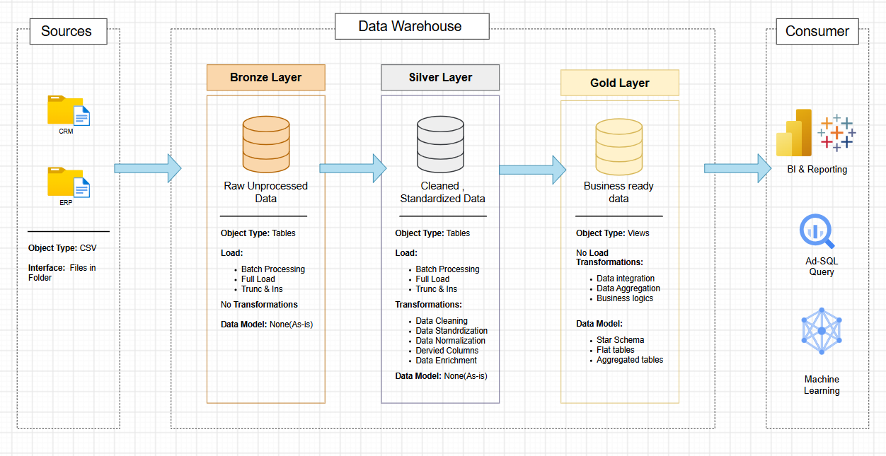

# 🛒 Retail Data Warehouse Project

<p align="center">
  <strong>A hands-on Data Engineering project for transforming historical retail data into trusted, business-ready insights.</strong>
</p>

<p align="center">
  
  
  
</p>

Welcome! 👋 This repository documents the development of a retail analytics data platform using historical sales, customer, and product data from six CSV files grouped into CRM and ERP source extracts.

The goal is to bring these separate datasets together, improve their consistency, and make them easier to use for historical sales analysis, customer insights, product performance analysis, and regional reporting.

This is a **one-time historical data integration project**. It does not include continuous ingestion or real-time processing.

## 🎯 Project Goals

- Consolidate sales, customer, product, and location data from multiple source files.
- Preserve the original source data before applying transformations.
- Clean, standardise, validate, and integrate the datasets.
- Organise the curated data into business-friendly analytical structures.
- Enable SQL-based analysis and reporting with Power BI.

## 🏗️ Architecture

The project follows a **Data Warehouse approach** organised using the **Medallion Architecture** pattern. Data moves through three layers, each with a distinct responsibility:



| Layer | Purpose |
|---|---|
| 🥉 **Bronze** | Stores the source data in its raw form. |
| 🥈 **Silver** | Cleans, standardises, validates, and integrates the data. |
| 🥇 **Gold** | Presents business-ready data for analytics and reporting. |

The Gold layer is planned to use dimensional modelling concepts to support analytical queries and BI reporting. The detailed data model and design decisions are documented separately.

## 📂 Repository Structure

```text
retail-data-warehouse-project/
├── data/
│   ├── source_crm/          # CRM CSV source files
│   └── source_erp/          # ERP CSV source files
├── docs/                    # Project documentation and diagrams
│   └── data_architecture.png
├── scripts/
│   ├── setup/               # Database and project setup
│   ├── bronze/              # Raw data loading
│   ├── silver/              # Data cleansing and integration
│   └── gold/                # Analytical model and views
├── tests/
│   ├── bronze/              # Bronze layer checks
│   ├── silver/              # Silver layer checks
│   └── gold/                # Gold layer checks
├── analytics/
│   ├── sql/                 # Analytical SQL queries
│   └── power_bi/            # Power BI reports and assets
└── README.md
```

## 🗃️ Source Data

The project uses six structured CSV files:

| Source group | Files | Business area |
|---|---|---|
| CRM | `cust_info.csv` | Customer information |
| CRM | `prd_info.csv` | Product information |
| CRM | `sales_details.csv` | Sales transactions |
| ERP | `CUST_AZ12.csv` | Additional customer attributes |
| ERP | `LOC_A101.csv` | Customer location information |
| ERP | `PX_CAT_G1V2.csv` | Product category reference |

The supplied data represents historical transactions and related customer and product information. Detailed schemas, data profiling results, and source-to-target mappings belong in the `docs/` folder rather than in this overview.

> **Data note:** Confirm that you have permission to publish the supplied datasets before committing the CSV files to a public repository. Do not publish personal or otherwise sensitive information.

## 🔄 Project Workflow

1. 📝 Requirements analysis and project scope.
2. 🔍 Source-system analysis and data discovery.
3. 🏛️ Architecture and layer design.
4. 🥉 Bronze layer: load and preserve raw source data.
5. 🥈 Silver layer: profile, clean, standardise, and integrate data.
6. 🥇 Gold layer: build the analytical data model.
7. ✅ Data quality testing and reconciliation.
8. 📊 SQL analysis and Power BI reporting.

## 📚 Documentation

Detailed project decisions and technical notes are maintained separately so this README stays focused on the project overview.

| Document | Description |
|---|---|
| `docs/requirements.md` | Business problem, requirements, scope, and assumptions. |
| `docs/source_data_dictionary.md` | Source files, columns, and business definitions. |
| `docs/architecture_decisions.md` | Architecture evaluation and design rationale. |
| `docs/data_flow.md` | Movement of data through the layers. |
| `docs/data_model.png` | Final analytical data model. |
| `docs/data_quality_rules.md` | Profiling findings and agreed quality rules. |

*These documents will be added as the project progresses.*

## 🧰 Technology Stack

The implementation stack will be documented here once the database platform, SQL environment, and loading approach have been selected. Power BI is the planned reporting tool.

## 🚀 Project Status

<details>
  <summary>View current progress</summary>

  - [x] Initial business problem and project scope drafted
  - [x] Source files identified
  - [x] High-level architecture diagram prepared
  - [ ] Detailed requirements documentation
  - [ ] Database and layer setup
  - [ ] Bronze layer implementation
  - [ ] Silver layer implementation
  - [ ] Gold layer modelling
  - [ ] Data quality testing
  - [ ] SQL analysis and Power BI reporting
</details>

## 📜 License

📜 This project is licensed under the [MIT License](LICENSE).

## 🙋‍♂️ About Me

Hi! I'm **Jayanth**, a student interested in Data Engineering, analytics, and building practical data platforms.

I'm using this project to learn and demonstrate the end-to-end Data Engineering workflow—from understanding business requirements and designing architecture to building data pipelines, modelling data, testing quality, and enabling analytics.

- GitHub: [Your GitHub profile](https://github.com/)
- LinkedIn: [Your LinkedIn profile](https://www.linkedin.com/)

## ⭐ Acknowledgements

This project is developed as a hands-on learning exercise using the supplied historical retail datasets. Feedback, suggestions, and constructive contributions are welcome!
